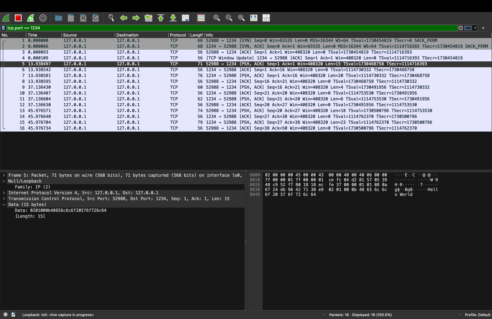
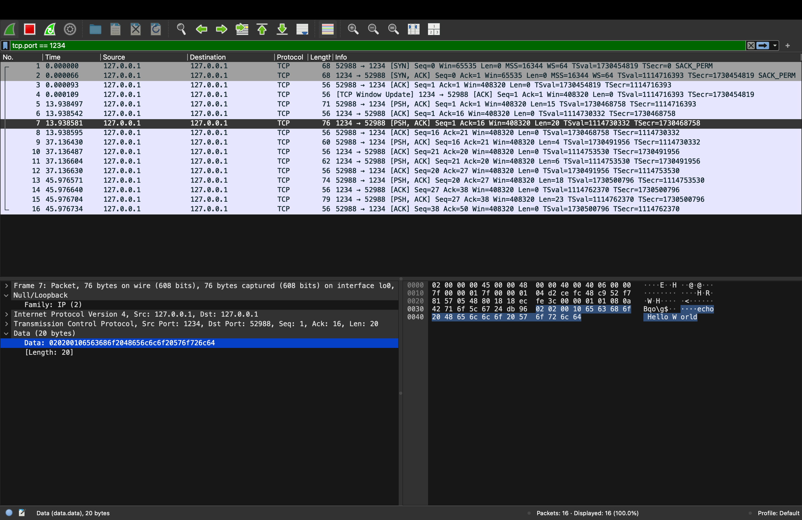
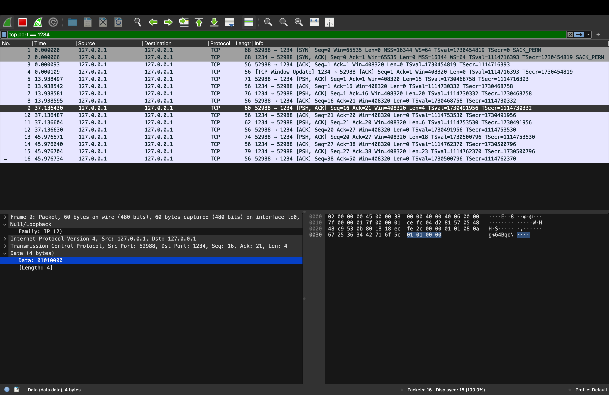
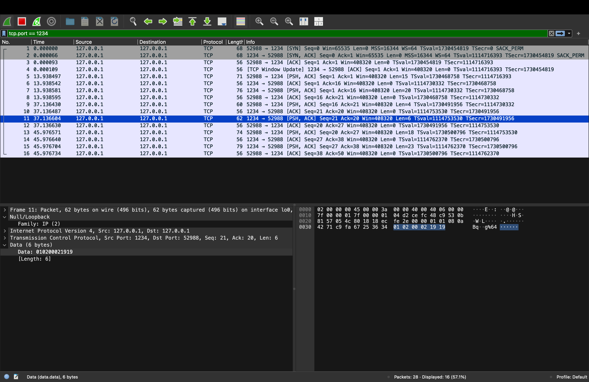
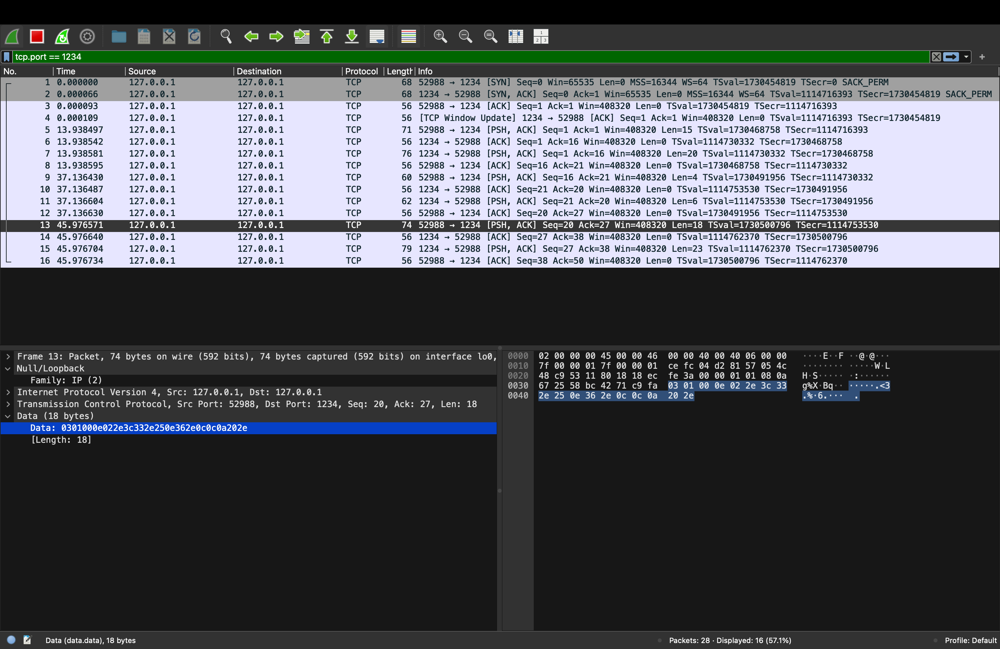
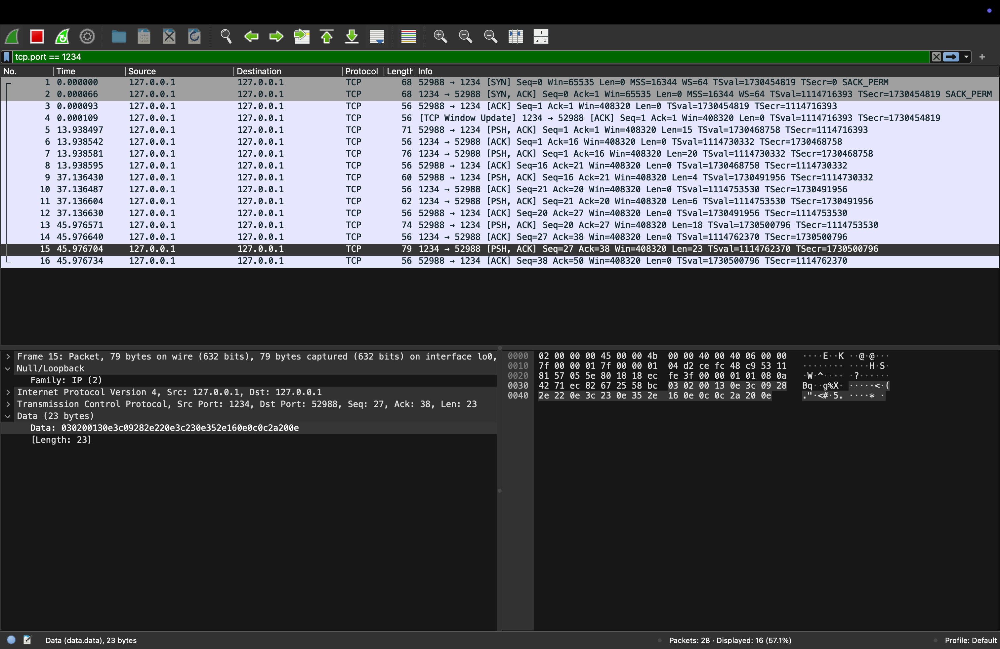
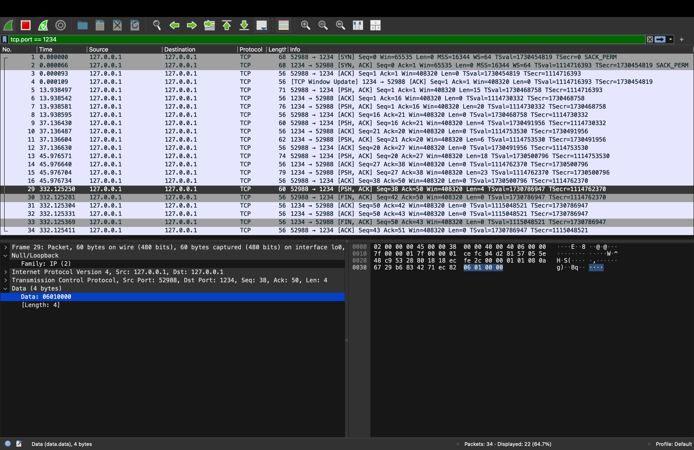
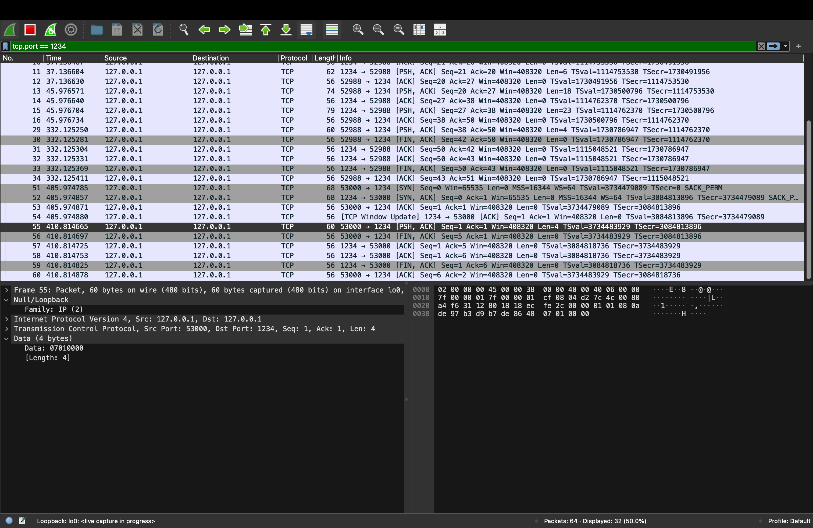

# Wireshark Protocol Analysis
## 1. Learning Process
I used ChatGPT to gain knowledge about TCP client-server implementation and network packets analysis via Wireshark.
Some of the prompts I asked were:
1. How do I recognize all the PDU field elements?
2. How do I capture TCP packets in Wireshark for the loopback interface?
3. How does `htons()` and `ntohs()` convert host byte order into network byte order?
4. How do I recognize plaintext messages, key exchanges, and encrypted messages in packet capture?

With the help of ChatGPT, I understood how protocol header works, how to read hexadecimal packets, and how to solve byte order problems.
One of the difficulties I had was that the initial transmission of payload length was done in little-endian order while it needed to be in network byte order. To resolve this issue, I had to convert my code from host byte order to network byte order by using `htons()` to send packet headers and `ntohs()` to receive them.

## 2. Capture Setup
TCP communication from the client to server was captured using Wireshark.
- **Network interface:** `lo0` (loopback interface)
- **Capture filter:** None
- **Display filter:** `tcp.port == 1234`
- **Server address:** `127.0.0.1`
- **Server port:** `1234`

Since both the client and server were on the same machine, the loopback adapter was used for capturing communications between them.
The client transmitted packets with an ephemeral source port to the destination port 1234. The server transmitted the reply packets from port 1234 to the client's ephemeral port.
Packets captured include plaintext communication, key exchange, encryption/decryption and client/server termination.

## 3. PDU Analysis
### A. Plain Text Message
The plain text `Hello World` was sent by the client to the server.
- **Frame:** 5
- **Message type:** `MSG_DATA` (02)
- **Direction:** `DIR_REQUEST` (01)
- **Payload length:** 11 bytes (`00 0B`)
- **Payload:** `Hello World`

The server responded with `echo Hello World`.
- **Frame:** 7
- **Message type:** `MSG_DATA` (02)
- **Direction:** `DIR_RESPONSE` (02)
- **Payload length:** 16 bytes (`00 10`)
- **Payload:** `echo Hello World`

Direction changes from request (01) to response (02). The header fields match the structure defined in `protocol.h`.
### B. Key Exchange

Client requested a key exchange.

- **Frame:** 9
- **Message type:** `MSG_KEY_EXCHANGE` (01)
- **Direction:** `DIR_REQUEST` (01)
- **Payload length:** 0 bytes

Server responded with encryption key.

- **Frame:** 11
- **Message type:** `MSG_KEY_EXCHANGE` (01)
- **Direction:** `DIR_RESPONSE` (02)
- **Payload length:** 2 bytes (`00 02`)

Response contains a 2-byte `crypto_key_t` value. The direction changes from request to response.

### C. Encrypted Message

After key exchange, client sent an encrypted message.

- **Frame:** 13
- **Message type:** `MSG_ENCRYPTED_DATA` (03)
- **Direction:** `DIR_REQUEST` (01)
- **Payload length:** 14 bytes (`00 0E`)

Payload contains non-readable encrypted bytes instead of the original plaintext message.
Server returned an encrypted response.

- **Frame:** 15
- **Message type:** `MSG_ENCRYPTED_DATA` (03)
- **Direction:** `DIR_RESPONSE` (02)
- **Payload length:** 19 bytes (`00 13`)

The response is 5 bytes longer because the server adds the `echo ` prefix before encrypting the response.

### D. Client and Server Shutdown

Client sent a shutdown command.

- **Frame:** 29
- **Message type:** `MSG_CMD_CLIENT_STOP` (06)
- **Direction:** `DIR_REQUEST` (01)
- **Payload length:** 0 bytes

Server shutdown command was also captured.

- **Frame:** 55
- **Message type:** `MSG_CMD_SERVER_STOP` (07)
- **Direction:** `DIR_REQUEST` (01)
- **Payload length:** 0 bytes

Both commands contain no payload, which means that their payload size is zero.

## 4. Protocol Verification
The packet captures were compared with the protocol definitions in `protocol.h`.

- **Header size:** The PDU header is 4 bytes, containing a 1-byte message type, a 1-byte direction, and a 2-byte payload length.
- **Message types:** The captured message types matched the definitions in `protocol.h`, including `MSG_DATA`, `MSG_KEY_EXCHANGE`, `MSG_ENCRYPTED_DATA`, `MSG_CMD_CLIENT_STOP`, and `MSG_CMD_SERVER_STOP`.
- **Direction:** Client requests used `DIR_REQUEST` (01), while server responses used `DIR_RESPONSE` (02).
- **Payload length:** The payload length was correctly represented in network byte order (big-endian).

One issue I found during testing was that the payload length was initially sent in host byte order. This caused the bytes to appear in the wrong order in Wireshark. I fixed this by using `htons()` when sending packet headers and `ntohs()` when receiving them.
After the correction, the packet captures showed the expected payload lengths and message types. The client and server communication, key exchange, encrypted messages, and shutdown commands worked successfully.

## 5. Wireshark Screenshots

### Plaintext Communication

### Key Exchange

### Encrypted Communication

### Shutdown Commands

